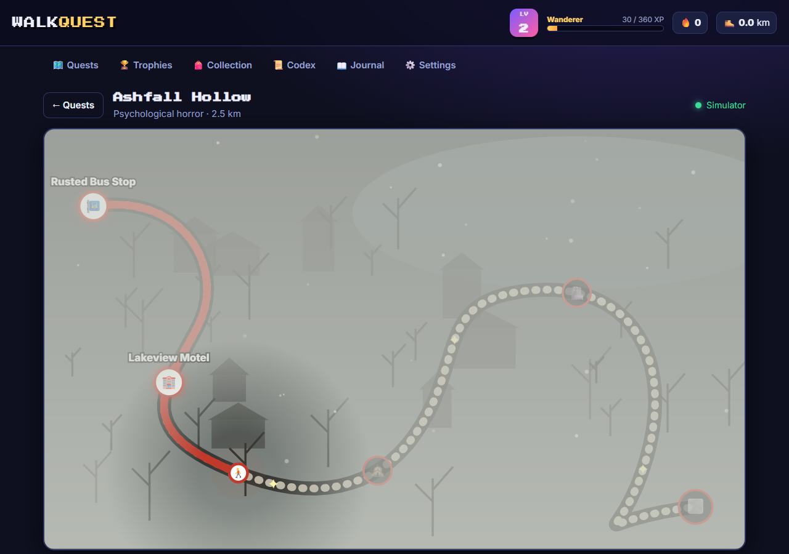
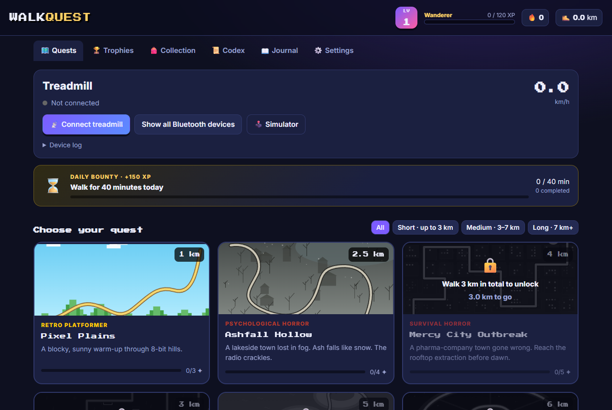
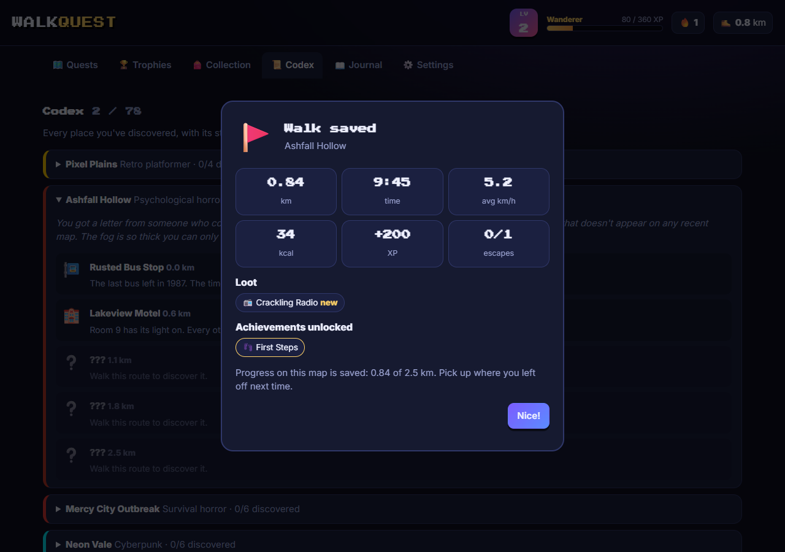
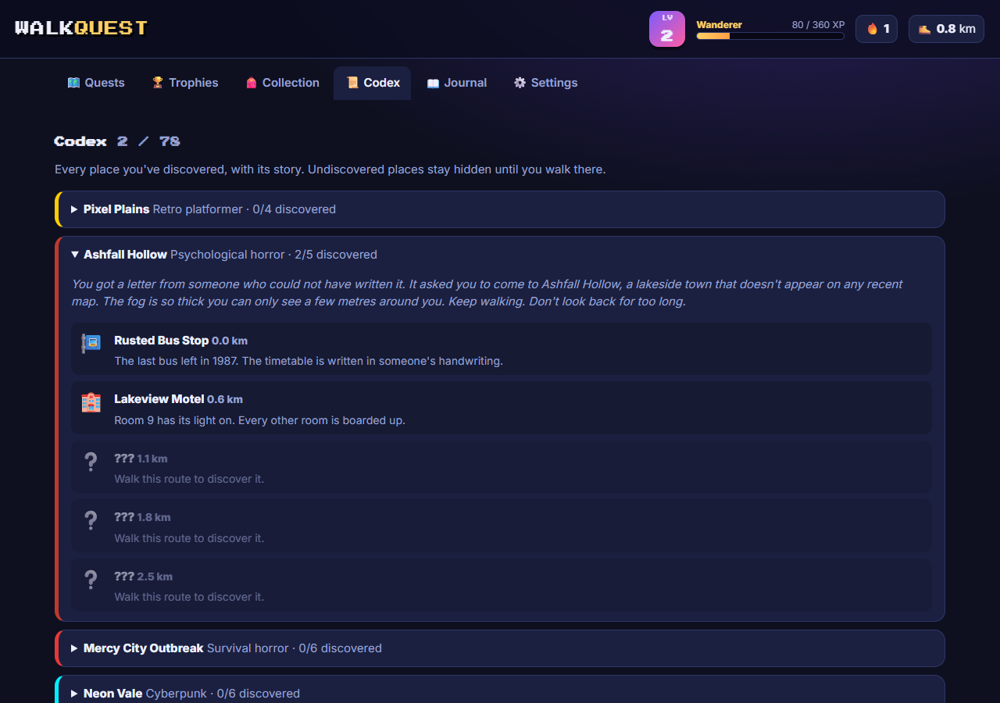
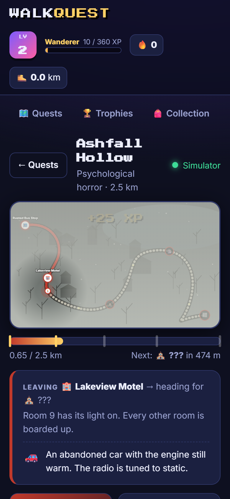

# WalkQuest

Turn treadmill walks into video-game journeys. Built for the inSPORTline ZenRun 10, and works with any treadmill that speaks the standard Bluetooth **FTMS** (Fitness Machine Service) profile. A FitShow-protocol fallback is included for walking pads that don't.

Pick a map, start walking, and your real treadmill speed moves you along the route: landmarks with lore, loot to collect, speed-challenge encounters, XP, levels and achievements. It's a plain web page with no build step and no account. Progress is saved in your browser, and if you run the small included server (`server.py`) it is kept there too, so your computer and phone stay in sync.

| Choose a quest | End-of-walk summary |
| --- | --- |
|  |  |
| **Codex of discovered places** | **On a phone** |
|  |  |

## Run it

Web Bluetooth only works in **Chrome or Edge** (Windows, macOS, Android, ChromeOS) and only on a secure page: `https://`, `http://localhost`, or a local file.

- **Quickest:** double-click `index.html` to open it in Chrome.
- **If Connect stays greyed out:** in this folder run `python3 -m http.server 8000`, then open http://localhost:8000.
- **Anywhere:** put the folder on GitHub Pages (or any static host). No build step.
- **With sync between devices:** run `python3 server.py` (Python 3.7+, nothing to install) and open http://localhost:8095. It serves the app and stores your progress in `data/`, so every device that opens WalkQuest from this server shares the same walks, XP, map progress and collection. See below.

Close the treadmill's own phone app before connecting: most treadmills accept one Bluetooth connection at a time.

It can be installed as an app (Chrome's "Install app" / "Add to Home screen"); it has its own manifest and icon.

On phones it works like an app: a tab bar along the bottom, a walk bar with speed, slower/faster and STOP while you walk, pop-ups as bottom sheets you can swipe down, and a saved copy of the app (`sw.js`) so the installed app opens even without a connection. Held sideways on the treadmill console, the map and the controls sit side by side.

## What's in it

- 12 original maps from 1 km to 15 km (retro platformer, foggy horror town, cyberpunk city, zombie-outbreak city, pirate islands, derelict space station, gothic manor, fantasy kingdom, desert tombs, dark-fantasy wasteland, Nordic mountains, deep-sea ruins). Longer maps unlock as your lifetime distance grows. Filter by short / medium / long.
- Each map has an intro story, landmarks with lore, and "sights": short descriptions of what you pass between landmarks. The Now Passing panel and the Route list show where you are; tap a discovered place to read about it.
- Codex of every place you've discovered, and a daily bounty worth bonus XP.
- Progress on a map is saved, so a 12 km quest can be split over several walks.
- Landmarks with lore, collectibles along the route, and **encounters**: short speed challenges ("hold 5.0 km/h for 60 s to escape").
- XP, levels and ranks, 34 achievements, daily streak, 7-week heatmap, walk history.
- **Speed control** from the app: ±0.1 / ±0.5 buttons, presets, Start belt and a big STOP button, plus keyboard shortcuts (Up/Down arrows, Shift for 0.5 steps, Esc to stop). Speeds are capped at the maximum set in Settings and at the treadmill's own reported range. During an encounter, **Match speed** sets the belt to the target. Uses the FTMS Control Point; FitShow-protocol treadmills get experimental set-speed and stop only. The treadmill's own stop button and safety key always work as usual.
- Simulator with 10x / 60x time warp for trying it without the treadmill.
- Progress is saved in the browser (localStorage) and, with `server.py`, synced between devices. Export/import a JSON backup in Settings.

## Syncing between devices

`server.py` serves the app and adds one small endpoint, `/api/state`, that holds your progress. The app finds it on its own: when it is there, progress syncs; when it isn't (a local file, GitHub Pages), everything stays in the browser as before.

- Sync happens when the app opens, a couple of seconds after a change, every 20 s during a walk, right after a walk ends, when you switch back to the app, and once a minute while it's open. Settings shows the sync status and has a **Sync now** button.
- Devices merge instead of overwriting each other, so nothing is lost if two of them were used offline: walks, collectibles, codex entries, achievements and bounties are combined, XP and encounter counts add up (each device keeps its own count), and on each map the most recent progress wins. A map you are walking right now is never changed by another device mid-walk.
- **Erase all progress** and **Import backup** replace the copy on the server, and the other devices take it on their next sync.
- The server keeps a dated copy of the progress once a day for the last 30 days in `data/`, in case you ever need to roll back by hand.
- Settings (environment variables): `WALKQUEST_PORT` (default 8095), `WALKQUEST_BIND` (default `127.0.0.1`, this computer only), `WALKQUEST_DATA` (default `./data`), `WALKQUEST_ROOT` (folder with `index.html`). There is no login, so only make it reachable on a network you trust, or put it behind something that adds https and access control. Phones need https for Web Bluetooth, so to walk with the phone connected to the treadmill, serve it over https (for example with a reverse proxy).

## Files

- `index.html`, `css/style.css`, `manifest.webmanifest`, `sw.js` (offline copy of the app), `icons/`
- `server.py`: optional server that serves the app and syncs progress between devices.
- `js/maps.js`: the first six maps and scenery painters.
- `js/maps-extra.js`: six more maps with their scenery painters. Add new maps here.
- `js/lore.js`: intros and sights for the first six maps.
- `js/devices.js`: Bluetooth (FTMS + FitShow) data, speed control and the simulator.
- `js/app.js`: game logic, UI and progress sync.
